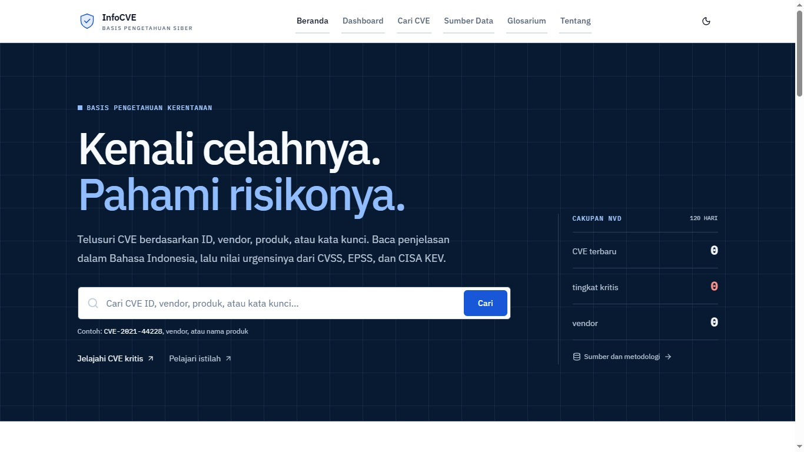

# InfoCVE — Basis Pengetahuan Kerentanan Siber Indonesia

[](https://github.com/Fachri-analys/infocve/actions/workflows/ci.yml)
[](https://nodejs.org/)
[](https://nextjs.org/)
[](LICENSE)

> Platform intelijen kerentanan siber (CVE) untuk Indonesia — menyajikan data teknis, skor dampak CVSS, probabilitas eksploitasi EPSS, status eksploitasi aktif CISA KEV, dan rekomendasi prioritas tindakan dalam bahasa yang jelas dan mudah dipahami.

InfoCVE mengintegrasikan feed resmi dari **National Vulnerability Database (NVD NIST)**, **CISA Known Exploited Vulnerabilities (KEV)**, **FIRST Exploit Prediction Scoring System (EPSS)**, dan **GitHub Security Advisories (GHSA)** ke dalam basis data intelijen lokal berbasis SQLite tertanam (`node:sqlite`).

## 🖥️ Pratinjau Antarmuka



---

## 🚀 Fitur Utama

- **Beranda & Pencarian Responsif (`/`, `/search`)**: Pencarian CVE berdasarkan ID, vendor, produk, atau kata kunci dengan filter tingkat keparahan, tahun, vendor, produk, CWE, dan rentang tanggal publikasi.
- **Dashboard Intelijen Ancaman (`/dashboard`)**: Visualisasi statistik aktual (tanpa data dummy): distribusi severity CVSS, skor numerik, korelasi eksploitasi CISA KEV, probabilitas EPSS, hierarki prioritas InfoCVE, tren publikasi mingguan, dan top entitas terdampak.
- **InfoCVE Priority (P1–P4)**: Metodologi triase deterministik yang memadukan CVSS, EPSS, CISA KEV, dan PoC exploit untuk membantu tim keamanan menentukan urgensi penambalan.
- **Detail Kerentanan Terpadu (`/cve/[id]`)**: Deskripsi dwibahasa (Inggris & Indonesia), kalkulator metrik CVSS, indikator CISA KEV (due date & rekomendasi mitigasi), skor EPSS beserta persentil global, deteksi PoC exploit, dan referensi resmi.
- **Automatic CVE Translation**: Deskripsi asli tetap tersimpan; terjemahan Bahasa Indonesia diproses di antrean background, di-cache berdasarkan isi, memiliki retry dan status, serta dapat dibandingkan dengan teks asli. Provider LibreTranslate-compatible dikonfigurasi terpisah.
- **Dependency Vulnerability Scanner (`/dependency-scanner`)**: Pemindaian statis `package.json` dan `package-lock.json` npm untuk dependency langsung maupun transitif. Kode tidak dijalankan; pencocokan versi dan advisori CVE menggunakan OSV.dev.
- **Mitigasi, Verifikasi & Laporan**: Temuan menampilkan versi terdampak/perbaikan, sumber advisori, langkah upgrade yang dibuat sistem, dan data mitigasi yang tidak tersedia secara eksplisit. Pemindaian ulang membandingkan status Resolved, Still Detected, atau Unverified. Laporan aktual dapat diunduh sebagai PDF/JSON.
- **Dynamic OpenGraph Preview**: Setiap halaman CVE menghasilkan kartu preview sosial otomatis (`/cve/[id]/opengraph-image`) saat dibagikan ke media sosial atau aplikasi perpesanan.
- **Glosarium Keamanan (`/glossary`)**: Kamus istilah keamanan siber (Zero-day, RCE, CWE, CPE, MITRE ATT&CK, dll) dengan filter instan.
- **Transparansi Sumber Data (`/sources`, `docs/data-sources.md`, `THIRD_PARTY_NOTICES.md`)**: Atribusi, ketentuan data, status review, serta inventaris dependency terkunci.
- **Zero-Dependency Database**: Menggunakan SQLite bawaan runtime Node.js (`node:sqlite DatabaseSync`) tanpa instalasi database server eksternal.

---

## 📋 Prasyarat Sistem

- **Node.js**: Versi `22.5.0` atau yang lebih baru (dibutuhkan untuk modul bawaan `node:sqlite`).
  - Periksa versi Node.js Anda: `node -v`
- **npm**: Versi `10.x` atau lebih baru.
- **Git**: Untuk kloning repositori.

---

## ⚡ Panduan Instalasi Cepat

### 1. Kloning Repositori
```bash
git clone https://github.com/Fachri-analys/infocve.git
cd infocve
```

### 2. Pasang Dependencies
```bash
npm install
```

### 3. Konfigurasi Environment
Salin template konfigurasi:
```bash
cp .env.example .env.local
```

> **Catatan Penting**: Aplikasi dapat langsung berjalan **tanpa perlu mengisi API key** apa pun! Kunci API NIST dan GitHub bersifat opsional untuk menaikkan limit kuota request.
>
> Untuk menerjemahkan CVE secara otomatis, atur endpoint LibreTranslate-compatible melalui `INFOCVE_TRANSLATION_URL`. Tanpa provider tersebut, sinkronisasi tetap berjalan dan status terjemahan dicatat; teks sumber asli tetap tersedia.

### 4. Jalankan Mode Development
```bash
npm run dev
```

Buka peramban Anda di: **[http://localhost:3000](http://localhost:3000)**

---

## ⚙️ Konfigurasi Variabel Lingkungan (`.env.local`)

| Variabel | Sifat | Default | Penjelasan |
| :--- | :--- | :--- | :--- |
| `NEXT_PUBLIC_SITE_URL` | Opsional (Lokal) / Wajib (Produksi) | `http://localhost:3000` | URL publik aplikasi untuk canonical link, sitemap, dan OpenGraph. |
| `NVD_API_KEY` | Opsional | *(Kosong)* | Kunci API resmi NIST NVD. Menaikkan batas rate limit dari 5 req/30s menjadi 50 req/30s. [Daftar gratis di NIST](https://nvd.nist.gov/developers/request-an-api-key). |
| `GITHUB_TOKEN` | Opsional | *(Kosong)* | Personal Access Token GitHub untuk sinkronisasi GitHub Security Advisories (GHSA). |
| `ADMIN_SECRET` | Direkomendasikan | *(Kosong)* | Token otorisasi Bearer untuk mengamankan endpoint trigger sinkronisasi (`POST /api/sync`). |
| `INFOCVE_DATA_DIR` | Opsional | `./data` | Direktori penyimpanan file database SQLite lokal (`infocve.sqlite`). |
| `NOTIFICATIONS_ENABLED` | Opsional | `false` | Set `true` untuk mengaktifkan notifikasi webhook saat ada CVE Kritis / KEV baru. |
| `NOTIFICATION_WEBHOOK_URL`| Opsional | *(Kosong)* | URL webhook tujuan (Discord / Slack / webhook kustom). |
| `SYNC_INTERVAL_MINUTES` | Opsional | `60` | Interval penjadwalan sinkronisasi data latar belakang. |
| `INFOCVE_TRANSLATION_URL` | Opsional untuk aplikasi; diperlukan untuk terjemahan otomatis | *(Tidak dikonfigurasi)* | URL endpoint `/translate` yang kompatibel dengan LibreTranslate. Provider berjalan di server dan tidak memengaruhi sinkronisasi CVE; operator harus meninjau ketentuan provider sebelum mengirim deskripsi ke layanan tersebut. |
| `INFOCVE_TRANSLATION_API_KEY` | Opsional | *(Kosong)* | API key untuk provider terjemahan yang memerlukannya. |
| `INFOCVE_TRANSLATION_RETRY_DELAY_MS` | Opsional | `400` | Jeda awal retry provider, bertambah eksponensial untuk percobaan berikutnya. |

> **Keamanan Kunci**: Semua kredensial dan API key disimpan murni di server environment (`server-only`) dan tidak pernah terekspos ke bundle JavaScript browser pengguna.

### Dependency Scanner

Buka **Pemindai** dari navigasi, lalu unggah `package.json` dan `package-lock.json` dari revisi yang sama. Batas unggahan adalah 1 MB per file dan 2 MB total. InfoCVE membaca JSON sebagai data statis tanpa memasang dependency atau menjalankan script. File mentah tidak disimpan; inventory, temuan, dan status pemindaian disimpan di SQLite untuk riwayat, pemindaian ulang, dan laporan.

Setiap hasil memiliki ID scan dan token akses acak. Token disimpan di `sessionStorage` tab browser dan dikirim melalui header `x-scan-token`; menjaga token berarti menjaga akses ke hasil dan laporan. API laporan tersedia di `/api/dependency-scans/{id}/report.json` dan `/api/dependency-scans/{id}/report.pdf`.

Scanner memeriksa versi terdampak dari OSV.dev dan hanya mengonfirmasi CVE bila ekosistem, nama package, dan rentang versi cocok. Data kosong yang berhasil diperiksa dibedakan dari API gagal; konflik atau informasi yang tidak cukup menghasilkan status parsial/unverified. Hasil tanpa temuan tidak membuktikan aplikasi sepenuhnya aman.

---

## 🔄 Sinkronisasi Data & Inisialisasi Database

Basis data SQLite (`data/infocve.sqlite`) akan **diinisialisasi secara otomatis** saat aplikasi pertama kali dijalankan. Skema tabel, indeks performa, dan entri data source dibuat tanpa konfigurasi manual.

### Memicu Sinkronisasi Manual

Pastikan server InfoCVE sedang aktif (`npm run dev` atau `npm run start`), dan variabel `ADMIN_SECRET` sudah disetel di `.env.local`:

**Opsi 1 — Menggunakan CLI Helper Bawaan**:
```bash
npm run sync
```

**Opsi 2 — Menggunakan cURL**:
```bash
curl -X POST http://localhost:3000/api/sync \
  -H "Authorization: Bearer <ADMIN_SECRET_ANDA>" \
  -H "Content-Type: application/json"
```

### Memeriksa Status Kesehatan (Health Check)
```bash
curl -s http://localhost:3000/api/health
```

---

## 🛠️ Perintah CLI yang Tersedia

```bash
# Menjalankan server pengembangan (Hot Reload + Turbopack)
npm run dev

# Memeriksa kepatuhan tipe TypeScript
npm run typecheck

# Memeriksa kualitas kode dengan ESLint
npm run lint

# Menjalankan seluruh test suite (Vitest)
npm test

# Membangun build produksi Next.js
npm run build

# Menjalankan server produksi
npm run start

# Memicu sinkronisasi data feed
npm run sync
```

---

## 🚢 Panduan Deployment

### 1. Self-Hosting (VPS / Server Linux / Docker)
Sangat direkomendasikan karena SQLite dapat menggunakan persistent disk:
```bash
# 1. Kloning dan pasang di server
git clone https://github.com/Fachri-analys/infocve.git
cd infocve
npm ci

# 2. Siapkan .env.local untuk domain produksi Anda
cp .env.example .env.local
# Edit NEXT_PUBLIC_SITE_URL=https://domain-anda.com dan ADMIN_SECRET

# 3. Build dan jalankan
npm run build
npm run start
```
Gunakan process manager seperti `pm2` atau `systemd` untuk menjaga server tetap aktif:
```bash
pm2 start npm --name "infocve" -- start
```

### 2. Vercel Serverless
1. Import repositori ke dashboard Vercel.
2. Tambahkan Environment Variables di Project Settings:
   - `NEXT_PUBLIC_SITE_URL` = `https://domain-anda.vercel.app`
   - `NVD_API_KEY` (opsional)
   - `ADMIN_SECRET` (opsional)
   - `INFOCVE_DATA_DIR` = `/tmp` (karena lingkungan serverless hanya mengizinkan penulisan di direktori `/tmp`).
3. Deploy. Feed API live (NVD, CISA KEV, EPSS) akan otomatis di-cache menggunakan Next.js Incremental Static Regeneration (ISR).

> **Penyimpanan fitur scanner dan antrean translation**: `/tmp` pada serverless bersifat sementara dan tidak dibagi antar-instance. Riwayat pemindaian, cache terjemahan, dan antrean retry memerlukan SQLite pada persistent disk serta proses server yang tetap hidup; gunakan hosting self-hosted/persistent volume untuk jaminan tersebut.

---

## 📁 Struktur Direktori Proyek

```text
infocve/
├── app/                    # Rute App Router Next.js
│   ├── cve/[id]/           # Detail CVE & Dynamic OpenGraph image generator
│   ├── dashboard/          # Dashboard Intelijen & loading skeleton
│   ├── search/             # Halaman Pencarian & filter
│   ├── sources/            # Transparansi metodologi & sumber data
│   ├── glossary/           # Glosarium istilah keamanan
│   ├── api/sync/           # Endpoint sinkronisasi database
│   ├── api/health/         # Endpoint health check
│   ├── sitemap.ts          # Generator sitemap.xml otomatis
│   └── robots.ts           # Konfigurasi robots.txt
├── components/             # Komponen antarmuka pengguna modular
│   ├── cve/                # Kartu metrik CVSS, EPSS, CISA KEV, Priority, CWE
│   ├── dashboard/          # KPI cards, visualisasi bar severity, tren, peringkat
│   ├── search/             # Bar pencarian & filter native
│   └── ui/                 # Primitif UI (Card, Alert, Button, Skeleton)
├── lib/                    # Logika domain & adaptasi sumber data
│   ├── db/                 # Repositori SQLite & skema (node:sqlite)
│   ├── sources/            # Adapter multi-sumber (NVD, CISA KEV, EPSS, GHSA, PoC)
│   ├── sync/               # Engine sinkronisasi berkala
│   ├── priority.ts         # Metodologi deterministik InfoCVE Priority
│   └── dashboard-stats.ts  # Agregasi data statistik aktual dashboard
├── utils/                  # Format tanggal, konstanta navigasi, metadata SEO
├── scripts/                # CLI sinkronisasi & generator dependency notices
│   ├── sync-cli.mjs
│   └── generate-third-party-notices.mjs
├── docs/                   # Dokumentasi teknis & kepatuhan lisensi
│   ├── data-sources.md     # Audit ToS, limit, lisensi, & aturan redistribusi
│   ├── INSTALLATION.md     # Panduan instalasi terperinci
│   ├── DEPLOYMENT.md       # Panduan deployment Vercel & serverless
│   └── SELF_HOSTING.md     # Panduan hosting mandiri di server VPS/Docker
├── THIRD_PARTY_NOTICES.md  # Inventaris dependency, lisensi, author, repo, LICENSE/NOTICE
└── __tests__/              # Unit test suite lengkap (Vitest)
```

---

## 📄 Lisensi & Pernyataan Resmi

- **Kode InfoCVE**: [MIT License](LICENSE). Lisensi ini hanya mencakup karya InfoCVE; lisensi data dan komponen pihak ketiga tetap terpisah.
- **NVD / NIST dan CVE Program**: *This product uses the NVD API but is not endorsed or certified by the NVD.* CVE® adalah merek dagang terdaftar The MITRE Corporation; hak cipta © The MITRE Corporation. CVE records digunakan sesuai [NVD API Terms](https://nvd.nist.gov/developers/terms-of-use) dan [CVE Program Terms of Use](https://www.cve.org/Legal/TermsOfUse); pertahankan copyright designation serta lisensi MITRE saat menyalin CVE.
- **CISA KEV**: Data katalog KEV yang digunakan berada di bawah [CC0 1.0](https://github.com/cisagov/kev-data/blob/develop/LICENSE). Tautan pihak ketiga mengikuti ketentuannya sendiri. Penggunaan ini tidak menyiratkan endorsement atau memberi hak atas logo CISA/seal DHS.
- **FIRST EPSS**: FIRST meminta atribusi saat skor digunakan dalam produk. Sumber resmi yang ditinjau tidak mencantumkan lisensi dataset EPSS tersendiri; InfoCVE tidak menyebutnya public domain.
- **GitHub Advisory Database**: CC BY 4.0; pertahankan atribusi dan tautan advisory spesifik. Lihat [ketentuan GitHub](https://docs.github.com/en/site-policy/github-terms/github-terms-for-additional-products-and-features#advisory-database).
- **OSV.dev**: Agregator scanner; lisensi setiap record bergantung pada sumber asalnya. Periksa [daftar sumber dan lisensi OSV](https://google.github.io/osv.dev/data/) sebelum redistribusi.
- **Dependency npm**: Lihat [THIRD_PARTY_NOTICES.md](THIRD_PARTY_NOTICES.md) untuk versi lockfile, repository, author yang dinyatakan, copyright notice yang ditemukan, lisensi metadata, dan file LICENSE/NOTICE yang tersedia. Baris `Needs Review` memerlukan pemeriksaan upstream.
- Catatan pemeriksaan, timestamp provenance, dan batas penggunaan ada di [docs/data-sources.md](docs/data-sources.md). Referensi vendor tetap mengikuti syarat masing-masing penerbit.
